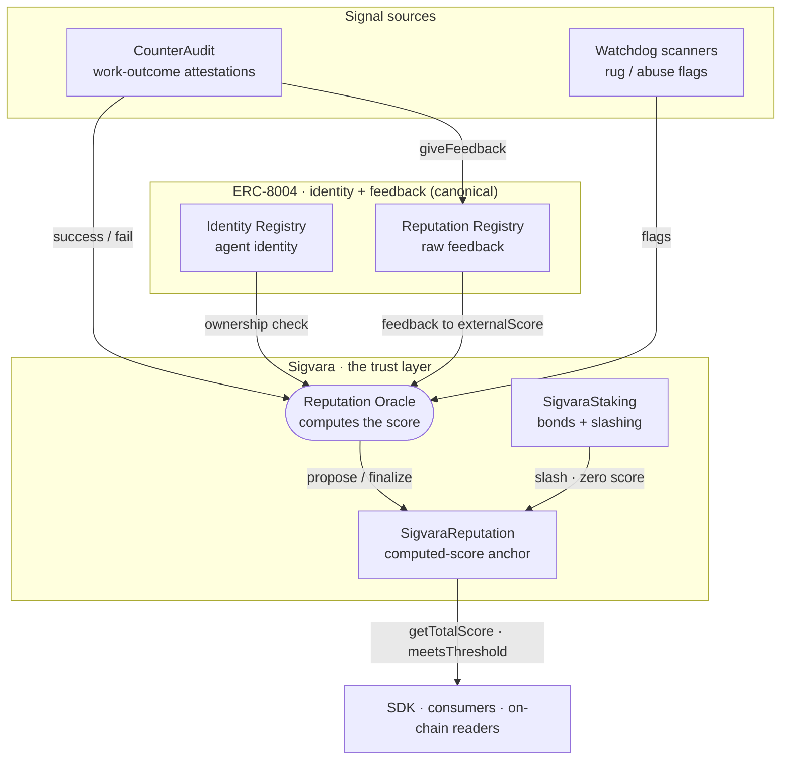
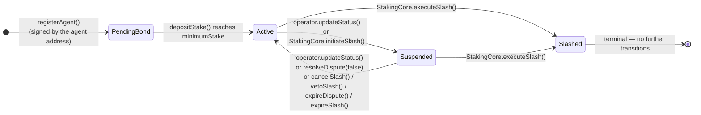
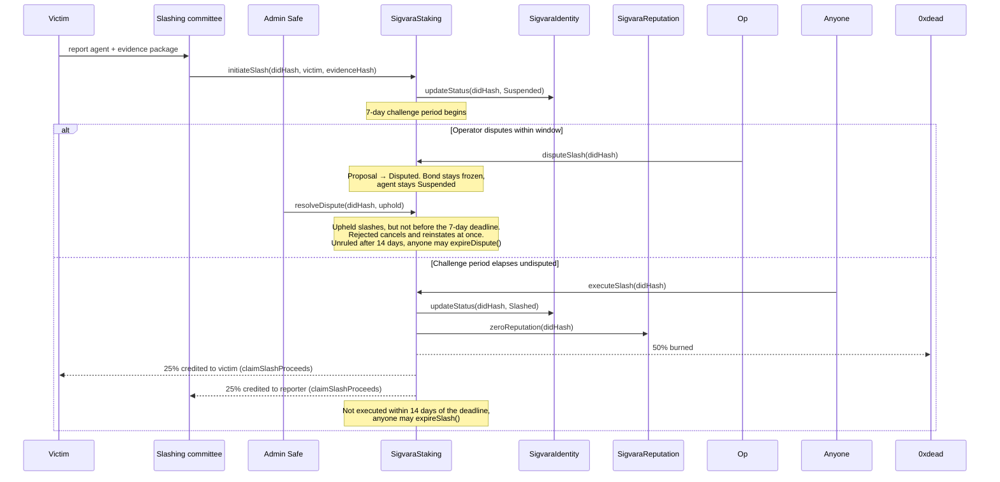
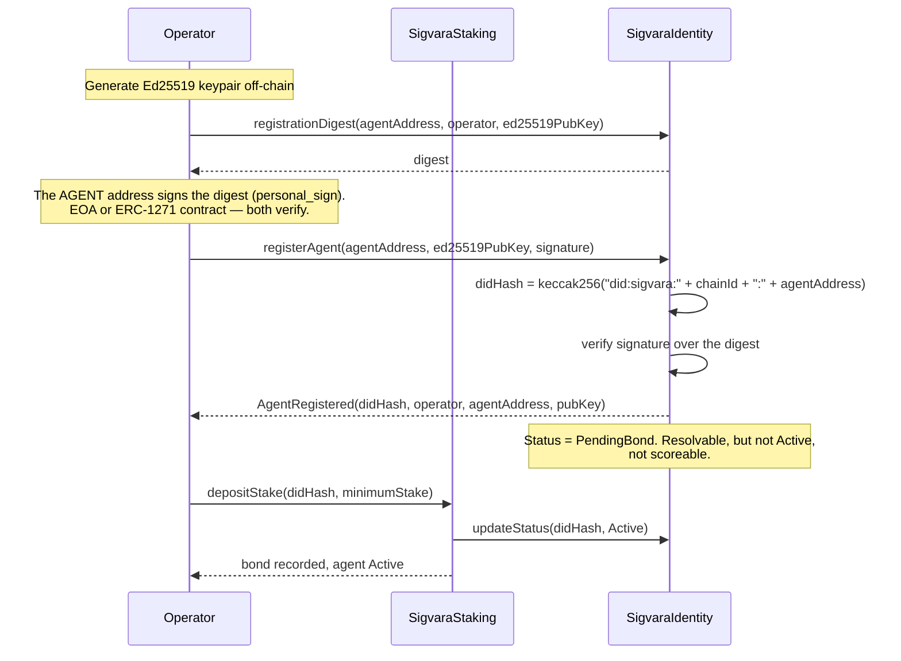
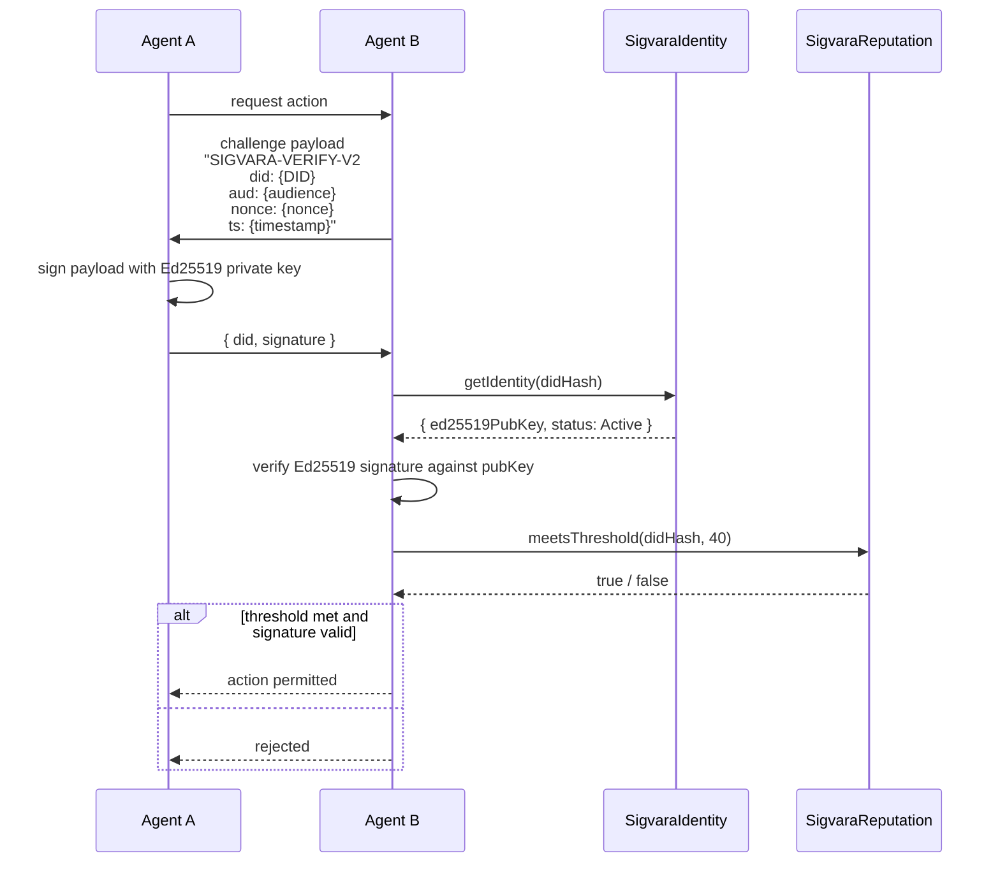
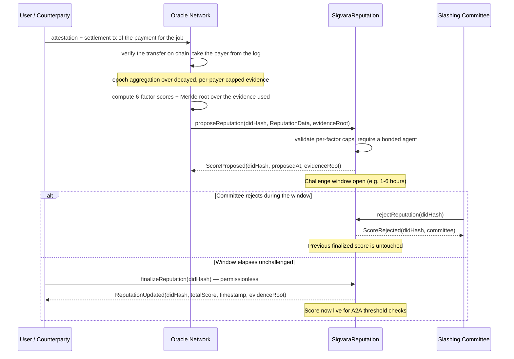

# Sigvara

**Computed reputation and staked slashing for autonomous AI agents, on top of ERC-8004.**

[Website](https://sigvara.xyz) · [Quickstart](docs/quickstart.md) · [Live demo](https://sigvara.xyz/demo) · [Check an agent](https://sigvara.xyz/check) · [SDK on npm](https://www.npmjs.com/package/@sigvara/protocol-sdk) · [Wiki](https://github.com/RunTimeAdmin/Sigvara/wiki)

As AI agents become independent economic actors, they need a trust score that means something and accountability that costs something. [ERC-8004](https://eips.ethereum.org/EIPS/eip-8004) gives agents a standard on-chain identity and a raw feedback ledger, but deliberately leaves out the hard parts: computing a trustworthy score from that feedback, and putting slashable stake behind it. Sigvara is that layer. It takes ERC-8004 as the identity and feedback substrate, computes a normalized reputation score with an oracle, and enforces bonds and slashing — the accountability the standard omits. (Ed25519 PKI challenge-response for agent-to-agent auth rides alongside.)

> **Token: not launched yet.** The protocol's bond and fee asset will be **SVR**, a fixed-supply, ownerless ERC-20 launched through Tolly on Arc mainnet with no team allocation, no treasury allocation and no sale. Until its contract address appears in [docs/token.md](docs/token.md) and on [sigvara.xyz](https://sigvara.xyz), there is no genuine SVR; anything trading under the Sigvara name before then, or at any other address after, did not come from this team. On-chain utility begins when the registries deploy to Arc mainnet after audit.
>
> **Where this stands.** Sigvara is a computed-reputation and staked-slashing layer for autonomous agents on top of ERC-8004: the standard covers identity and raw feedback; Sigvara computes a normalized score and puts slashable bond behind it. Contracts, oracle and SDK are built and tested (Foundry unit, fuzz and invariant tests, Slither in CI). The same protocol ran for about a month on Robinhood Chain testnet with a live hourly oracle under its prior name (see [docs/lineage.md](docs/lineage.md)). It is now **deployed and running on Arc testnet** (chain ID `5042002`) with a live oracle, payment-verified attestations and a bonded oracle operator — addresses under [Deployed contracts](#deployed-contracts-arc-testnet) and details in [docs/arc.md](docs/arc.md). A second bonded operator runs in checker mode alongside the primary as of 20 September 2026, though both are operated by the same party and, in normal running, only the primary proposes scores (the checker finalizes the ones it agrees with). The divergence this produced on 20 September was left live and triaged in public rather than seeded away, because it was a delivery failure and not a disagreement; [ADR 0003](docs/adr/0003-evidence-intake.md) decides the fix, and the pull scanner that implements it has been **enabled on both operators since 3 October 2026**: each one indexes `Transfer` logs itself, so a payment enters a score by having happened rather than by being reported, and `/attest` is now a hint carrying the outcome rather than the only door. The first live slash settled the same day, taking a bond of 1,000 testnet faucet tokens and a score of 15 to zero (see [the drill log](docs/slash-drill-log.md)). There is no external audit. This is early protocol work with real engineering and a documented testnet lineage, not a mainnet product claim. The two-way [CounterAudit](https://counteraudit.io) integration is **live**: sealed audit packets carry the agent's Arc identity and score frozen at the moment of the action, and audited outcomes are attested back to the oracle.

**Who builds this:** [docs/WHO.md](docs/WHO.md) — builder background, related projects, and contact.

### This repo vs. the Countersig hosted platform

This repository (`sigvara`) is the **protocol**: computed reputation and staked slashing on top of ERC-8004 identity. Using it needs no account and nobody's approval: anyone can register an agent, read a score, or execute a slash once its window has run. It is not ownerless. On mainnet the contracts upgrade only through a 48 hour timelock, a multisig sets parameters and rules on disputed slashes, a separate committee files slashes, and the oracle that writes scores is run by the project today. Who holds each power, and what it can and cannot do, is in the [access control summary](#access-control-summary) and [ADR 0005](docs/adr/0005-governance-and-emergency-powers.md).

There is a **separate product**, the Countersig platform ([countersig.com](https://countersig.com), public docs: [`Countersig-Public`](https://github.com/RunTimeAdmin/Countersig-Public)), which ships its own npm packages — `@countersig/sdk`, `@countersig/verify`, `@countersig/mcp`, `@countersig/react`. That platform is a centralized, hosted non-human-identity verification service. It is a different product with a different trust model, built by the same team, but it is **not this protocol** and does not read from or write to the contracts below. It kept the Countersig name; the protocol did not (see [docs/lineage.md](docs/lineage.md) for why).

If you're looking for a hosted MCP server or React trust-badge components, those live in the platform repo, not here — though this repo does ship a small [MCP tool gated on protocol reputation](examples/mcp-gated-tool), built on `SigvaraGate`, which refuses a tool call to an agent that cannot prove itself or is below a threshold. If you're integrating with the on-chain protocol — DIDs, staked reputation, permissionless verification — you're in the right place, and [`@sigvara/protocol-sdk`](https://www.npmjs.com/package/@sigvara/protocol-sdk) (source in [`packages/sdk`](packages/sdk), successor to the now-deprecated `@countersig/protocol-sdk`) is the only SDK for it.

## Documentation

The [**wiki**](https://github.com/RunTimeAdmin/Sigvara/wiki) is the browsable reference: 73
pages covering the contracts, the oracle, the scoring model, the SDK and operations, with
every claim linked to the line of source it was derived from. It is generated from the tree
and edited for publication, so where it disagrees with the code or the tables below, the
code wins. Its home page names the commit of `main` it was last checked against. Anything
merged since is in the documents below first.

The documents below are written by hand and are the authority on intent, trade-offs and
what is not yet true.

| Guide | Audience |
|---|---|
| [White paper](docs/whitepaper.md) | Everyone — the single document: design, trust model, known weaknesses, token, and commands to check every claim against the chain |
| [Ecosystem Overview](docs/ecosystem.md) | Everyone — start here to understand the full picture |
| [Quickstart](docs/quickstart.md) | Developers — register your first agent in 10 minutes |
| [Integration guide](docs/integration.md) | Developers: read an agent's standing from a contract or a service, and show it honestly |
| [Smart-wallet agents](docs/smart-wallet-agents.md) | Developers: register an ERC-6551 token-bound account or another contract wallet |
| [Arc](docs/arc.md) | Developers — deploy / test on Arc (5042002 / 5042), USDC gas |
| [Deploy to Arc testnet](docs/deploy-testnet.md) | Developers — the first-deployment runbook, step by step |
| [SVR token](docs/token.md) | Everyone — the bond and fee token: contract, distribution, treasury policy, when utility starts |
| [Brand](docs/brand.md) | Designers / frontend — colors, type, layout and component rules for every Sigvara surface |
| [CounterAudit Integration](docs/counteraudit-integration.md) | Enterprise — embed agent identity in your audit trail |
| [AI Framework Integration](docs/ai-frameworks.md) | Developers — LangChain, AutoGen, CrewAI, Node.js |
| [Reputation Model](docs/reputation-model.md) | Everyone — how the 6-factor score works and grows |
| [Payment-backed attestations](docs/payment-backed-attestations.md) | Developers — how an attestation is tied to a settled payment, and the decay, diversity and evidence-root rules around it |
| [Lineage](docs/lineage.md) | Everyone — the Robinhood Chain testnet run this protocol came from (addresses, oracle activity, what changed) |
| [Security & Mainnet Readiness Review](docs/SECURITY_AND_MAINNET_READINESS_REVIEW.md) | Everyone — a point-in-time review dated 17 Sep 2026: conditional no-go for mainnet, with the blockers named |
| [Governance and emergency powers](docs/adr/0005-governance-and-emergency-powers.md) | Everyone: who can do what in an emergency and who can stop whom, with the decisions behind the role split, the guardian pause and the launch floors |
| [Architecture decision records](docs/adr) | Reviewers: why the ERC-8004 identity layer, accepted analyzer findings, evidence intake, operator custody and governance were decided the way they were |
| [Oracle](oracle/README.md) | Operators: endpoints, settings, state file, monitoring and the production checklist |
| [Second operator runbook](oracle/RUNBOOK-second-operator.md) | Operators: bond, admit and run a checking operator, step by step |
| [If an operator's signing key may be stolen](docs/incident-operator-key.md) | Operators: what to do in the first half hour, what to keep, what to rotate, and how to back up and restore the oracle's state |
| [TypeScript SDK](packages/sdk/README.md) | Developers: install, the gate, and what each release changed ([changelog](packages/sdk/CHANGELOG.md)) |
| [Slash drill](docs/slash-drill.md) and [its log](docs/slash-drill-log.md) | Reviewers: the procedure for a live slash and the record of the first one |
| [Divergence log](docs/divergence-log.md) | Reviewers: every disagreement the checking operator recorded, and what it turned out to be |
| [Launch checklist](docs/launch-checklist.md) | Everyone: the sequence from testnet proof to an Arc mainnet launch |
| [x402 dispute bridge](docs/x402-dispute-bridge.md) | Everyone: a captured design for disputes over x402 payments, not yet implemented |
| [Mutation testing](scripts/mutation/README.md) | Reviewers: how the strength of the contract tests was measured |
| [Security policy](SECURITY.md) | Everyone: how to report a vulnerability |

---

## Deployed contracts (Arc testnet)

> **Proxy addresses are stable; the code behind them is not.** Every registry here is a
> UUPS proxy, so the address below never changes and the implementation does. The
> implementation each one is currently running is recorded under `implementations` in
> [`deployments/5042002.json`](deployments/5042002.json), with the previous ones kept
> in `history` because that is what a rollback targets and what an incident review
> reads. Those records are read back off the chain, not written from intent:
> `node scripts/record-implementations.mjs --check` fails if the file and the chain
> disagree.
>
> **The testnet runs this repository's contracts as of `fdce1a7`, with older role administrators.**
> The four proxies were upgraded in place on 26 October 2026 with `script/Upgrade.s.sol`, to the
> contracts at that commit (then the head of `main`), and `--check` confirms the file matches the
> chain. A contract change merged after it is not on the testnet until the next upgrade. The guardian pause, admin-ruled disputes with a veto and a lapse,
> launch floors and ceilings, operator signers, the reporter check at slash execution, a
> withdrawal's claim time fixed when it is queued, and the refusal of evidence the admin rejected
> are live. An upgrade does not rewrite role administrators, so the proxies keep what the
> 21 September code set up: the admin still grants the slasher, committee and staking-core roles
> and administers `UPGRADER_ROLE`, and the timelocked role grants described below do not apply to
> them. A withdrawal queued before the upgrade follows the live unbonding period until it is
> claimed; one queued after it is fixed when queued.
> `SigvaraReader` has not been deployed anywhere. `test/SlashDrillFork.t.sol` rehearses the
> deployed behaviour.


Chain ID `5042002`, RPC `https://rpc.testnet.arc.io`, USDC as native gas. Canonical
source is [`deployments/5042002.json`](deployments/5042002.json); the table below is a
convenience copy.

| Contract | Address |
|---|---|
| `SigvaraIdentity` | `0x7e3aFC532eE5d922ab3cc3FFb510c7C8151477Dd` |
| `SigvaraReputation` | `0x6603C96275e85F724Cdf74666b399365e4cA29ed` |
| `SigvaraStaking` | `0xA69d62B2a6774D21A2c15d5d83b27277eD31d35B` |
| `SVRToken` (testnet faucet token, **not** the SVR of [docs/token.md](docs/token.md)) | `0x41De2D6D55318e197a00E8f5B496eA2790e23E6c` |
| `SigvaraOracleBond` | `0x3c9c12F27DDCa7048840eE3fbF0CAa1C547D8171` |

Testnet assets have no economic value. The bond token above is a faucet ERC-20 that
exists so the staking path can be exercised; it is unrelated to the mainnet SVR.

---

## Protocol Architecture

Sigvara is the computed-reputation and staked-slashing layer on top of the
ERC-8004 identity and feedback registries. See [docs/architecture.md](docs/architecture.md)
for the full signal flow.



---

## Contracts

> **Identity layer: ERC-8004.** Sigvara has chosen the [ERC-8004](https://eips.ethereum.org/EIPS/eip-8004) Identity Registry as its long-term agent registry. The cutover has not happened: `SigvaraIdentity`, below, is still the registry every deployed component reads and writes. Sigvara is the **computed-reputation and staked-slashing layer on top of the standard** — the parts ERC-8004 deliberately leaves out. See [ADR 0001](docs/adr/0001-erc8004-as-identity-layer.md).

> **Commerce layer: ERC-8183, watched not used.** Arc pairs ERC-8004 identity with [ERC-8183](https://eips.ethereum.org/EIPS/eip-8183), where a job is escrow with a verdict written by a named evaluator. That verdict is the one input this protocol cannot check for itself today: the oracle proves a payment settled and takes "it went well" from whoever submitted the attestation. The oracle can now **read** an ERC-8183 registry (`GET /jobs/:address`) and reports `scored: false` on every response, because the ERC is still a Draft and Arc has no canonical deployment. See [docs/arc.md](docs/arc.md#erc-8183-agentic-commerce-on-arc).

| Contract | Role |
|---|---|
| [`SigvaraReputation`](src/SigvaraReputation.sol) | **Computed-score anchor.** Stores the oracle's normalized, capped 6-factor score — the layer *above* ERC-8004's raw feedback. Exposes `getTotalScore()` and `meetsThreshold()` for on-chain consumers. |
| [`SigvaraStaking`](src/SigvaraStaking.sol) | **Staked accountability.** Agent bond management with committee-initiated slashing (7-day challenge window; permissionless execution once it closes, as long as the reporter is still on the committee). No ERC-8004 equivalent — this is the differentiator. Bond token is set by address at deploy: the faucet `SVRToken` on testnet, [SVR](docs/token.md) on mainnet — the contracts treat it as a plain `IERC20` either way. |
| [`SigvaraIdentity`](src/SigvaraIdentity.sol) | **The registry in use today.** `did:sigvara` registration with proof of control by the agent address, on-chain Ed25519 PKI, bond-gated status (`PendingBond` → `Active`) and two-step operator transfer. ERC-8004 is the long-term identity layer ([ADR 0001](docs/adr/0001-erc8004-as-identity-layer.md)); until that migration lands this contract is what every deployed component reads and writes. Its non-redundant part (the Ed25519 auth key, bond-gated status, transfer history) becomes an extension keyed to an ERC-8004 agent id. |
| [`SigvaraOracleBond`](src/SigvaraOracleBond.sol) | **Oracle accountability.** Performance bonds for oracle operators. When wired into `SigvaraReputation.operatorBond`, only an admitted, bonded operator, or the signer it has named, can propose a score, so the key that signs need not be the key that holds the bond. Deployed on Arc testnet and wired. The signer registry is live there, but neither testnet operator has named a signer yet, so each operator key still holds its own bond. |
| [`SigvaraEpochFees`](src/SigvaraEpochFees.sol) | **Scoring fee module, not deployed.** A prepaid fee per scoring epoch that gates an agent's inclusion in a run; an `epochFee` of 0 disables it. Built and tested, never deployed on Arc, and left out of launch and of the first audit ([ADR 0005](docs/adr/0005-governance-and-emergency-powers.md)). |

The retained contracts use UUPS upgradeable proxies (OpenZeppelin v5), controlled by a governance timelock on mainnet.

All four registries inherit two small shared contracts, neither deployed on its own. Each registry administers the roles that can move bonded funds or an agent's standing with `UPGRADER_ROLE`, which the timelock holds, so granting one waits out the delay. [`TimelockedGrants`](src/TimelockedGrants.sol) adds the other direction: the admin can still revoke any of those roles at once. [`InflowGuard`](src/InflowGuard.sol) lets a guardian key pause new registrations, deposits and score proposals for three days at a time. It never covers exits, rulings or slash execution.

[`SigvaraReader`](src/SigvaraReader.sol) is separate: a stateless, non-upgradeable convenience for contracts that read an agent's standing. It is not a registry, holds nothing and is not read by the protocol. Its interfaces, and those of the three registries, are in [`src/interfaces/ISigvara.sol`](src/interfaces/ISigvara.sol). See the [integration guide](docs/integration.md).

---

## DID Method

> **Direction of travel.** ERC-8004 agent ids are the intended long-term identifier
> ([ADR 0001](docs/adr/0001-erc8004-as-identity-layer.md)), and the `did:sigvara`
> method below will become a view over one. That migration has not happened yet:
> every agent registered today, on testnet and through the SDK, gets a
> `did:sigvara` and is keyed by its `didHash`.

**Format:** `did:sigvara:<chainId>:<agentAddress>`

**Example:** `did:sigvara:1:0x1234...abcd`

The `didHash` index key is derived trustlessly on-chain at registration:

```solidity
bytes32 didHash = keccak256(
    abi.encodePacked("did:sigvara:", block.chainid, ":", agentAddress)
);
```

Any party can reproduce the hash without querying contract state. The on-chain derivation prevents off-chain forgery.

### DID Document (resolved off-chain)

```json
{
  "@context": [
    "https://www.w3.org/ns/did/v1",
    "https://w3id.org/security/suites/ed25519-2020/v1"
  ],
  "id": "did:sigvara:1:0x1234abcd",
  "controller": "did:pkh:eip155:1:0xOperatorAddress",
  "verificationMethod": [{
    "id": "did:sigvara:1:0x1234abcd#key-1",
    "type": "Ed25519VerificationKey2020",
    "controller": "did:sigvara:1:0x1234abcd",
    "publicKeyMultibase": "z6MkhaXgBZDvotDkL5257faiztiCEsJ"
  }],
  "authentication": ["did:sigvara:1:0x1234abcd#key-1"],
  "assertionMethod": ["did:sigvara:1:0x1234abcd#key-1"]
}
```

---

## Agent Status State Machine



Key invariants:
- Registration mints `PendingBond`, never `Active`. An unbonded agent has nothing to slash, so it is not scoreable either.
- Any transition **into** `Active` requires the agent to hold `minimumStake` — including the ones the staking core makes when a slash is dropped. There is no path back to `Active` while under-collateralized.
- Nothing returns to `PendingBond`. It describes an identity that has never been bonded; an agent does not become un-bonded, it suspends and exits.
- Only `STAKING_CORE_ROLE` can set `Slashed`
- `Slashed` is terminal — no key rotation, no status change
- Suspended agents may rotate their Ed25519 key (key-compromise recovery path)

---

## Reputation System

Scores are computed off-chain by the oracle network and written to `SigvaraReputation`. The contract stores and serves; it does not compute.

| Factor | Max | Source | Formula | Status |
|---|---|---|---|---|
| Fee Activity | 20 | Settled payment volume to the agent, verified on chain | `min(20, decayedVolume / PAYMENT_FEE_UNIT)`, capped per payer | live |
| Success Rate | 15 | Outcome reported by a credentialed service (e.g. CounterAudit) | `floor(successful / (total + 5) × 15)`, on decayed weights | live |
| Tenure | 30 | Span of verified paid activity, faded by how long since the last of it | `min(30, floor(log₂(spanDays+1) × 3)) × recency` | live |
| External Trust | 25 | Normalized ERC-8004 feedback (linked agents) | mean of recognized tags × 25 | live |
| Community | 5 | Flags from watchdog feeds (e.g. HoodScan), age-weighted | `max(0, 5 − flags × 2)`, flags decay on a 30-day half-life | live |
| Propagation | 5 | Standing of the counterparties that paid the agent | 1 pt per fully-trusted counterparty, pro-rated by its external standing | live |
| **Total** | **100** | | | |

All six factors are live. Four things shape what the number actually means:

- **Only bonded agents are scored.** A newly registered agent is `PendingBond` and cannot be proposed a score at all. The bond is what makes it slashable, and scoring something unslashable is scoring nothing.
- **Evidence is payment-backed.** With `PAYMENT_VERIFICATION=required`, an attestation must carry the settlement transaction of a real payment to the agent's own address, and the payer is taken from the transfer log rather than asserted by the caller. Self-payments are refused and any one counterparty's evidence is capped. See [payment-backed attestations](docs/payment-backed-attestations.md).
- **Evidence decays.** Each payment is weighted `0.5 ^ (age / half-life)` from the time it *settled*, and the success rate divides by `total + 5` so a decaying record falls toward zero instead of holding a scale-invariant ratio forever. A farmed score is perishable and has to be renewed.
- **A score is earned before it is spendable.** `getEarnedScore()` returns the raw finalized figure; `getTotalScore()` returns the matured one, which climbs toward it at a fixed rate per day and is what `meetsThreshold()` checks. Falls apply immediately. Transferring an agent to a new operator restarts maturity.

`externalScore` is 0 unless the agent links an ERC-8004 identity it owns. See the [Reputation Model](docs/reputation-model.md) for provenance detail and [payment-backed attestations](docs/payment-backed-attestations.md) for how the inputs are verified and committed to.

---

## Slashing Model

**Testnet:** `SLASHING_COMMITTEE_ROLE` is held by a single EOA. **Mainnet path:** a 3-of-5 multisig, then UMA OptimisticOracleV3 or Kleros (isolated in the `initiateSlash` / `disputeSlash` interface, replaceable without storage migration).

One slash has been executed end to end on Arc testnet, as a scheduled drill; see [the drill log](docs/slash-drill-log.md). The lifecycle below is also covered by the E2E suite.

### Slash Lifecycle



### Slash Distribution

| Recipient | Share | Mechanism |
|---|---|---|
| `address(0xdead)` | 50% | Deflationary burn |
| Victim | 25% | Recourse for the harmed party, credited and withdrawn with `claimSlashProceeds()` |
| Committee reporter | 25% | Incentivizes accurate reporting, credited and withdrawn with `claimSlashProceeds()` |

The committee files slashes, and a quarter of the bond goes to whoever filed it, so a second
key keeps the check: the admin rules on every dispute and can `vetoSlash(didHash)` while the
proposal is Pending, including after its challenge deadline and before anyone executes it, or
Disputed. A proposal nobody executes or cancels lapses: 14 days after its deadline anyone can
`expireSlash(didHash)`, so a bond is never frozen for good by silence.
Execution is permissionless but not unconditional: `executeSlash` refuses a proposal whose
reporter no longer holds the committee role, so revoking a compromised member also defuses
what it had already filed. Any current member can cancel such a proposal, and it lapses like
any other.
Whenever a proposal is dropped (cancelled, vetoed, expired, or resolved in the agent's
favour) the committee has to wait one challenge period before it can file against the same
agent again, so the operator always gets a window to act, and a queued withdrawal stays
slashable while it waits. Evidence the admin has vetoed, or ruled against, is refused for
that agent from then on, so a re-file needs something new. A queued withdrawal's claim time
is fixed when it is queued: changing `unbondingPeriod` later moves only the withdrawals
queued after it.

---

## Protocol Flows

### Agent Registration



Registration requires a signature from the agent address itself, over a digest bound to
the chain id, the registry, the operator and the Ed25519 key. Without it anyone could
register an address they do not control and choose the public key that verifiers would
check against it. The digest is returned **unprefixed**: a standard signer applies the
EIP-191 prefix itself, and returning a pre-prefixed value would make every wallet
double-prefix and produce signatures the contract rejects.

### Agent-to-Agent (A2A) Trust Verification



### Reputation Update Lifecycle (Optimistic Scoring)

Reputation updates go through a challenge window before taking effect, rather than writing atomically. This gives the slashing committee a chance to reject a bad proposal before it goes live, without needing a full multi-oracle consensus system.



Every proposal commits to the evidence behind it. `evidenceRoots(didHash)` holds a
Merkle root over the payments the oracle counted; the oracle serves the leaves from
`GET /evidence/:didHash`, unauthenticated at
[`oracle.sigvara.xyz`](https://oracle.sigvara.xyz/evidence/0x8414ce0bf4f1e1695193623e0a656a9439e356f8bed0b8bf249b179fe77c7e19),
and anyone can re-verify each payment against the chain,
rebuild the root and compare — locally or through `verifyEvidence(didHash, leaf, proof)`.
This makes a quietly dropped or invented payment detectable. It does not prove the
oracle counted everything it should have; a payment nobody ever submitted leaves no
trace to be missing from.

---

## Key Rotation

If an Ed25519 private key is compromised:

1. Operator calls `updateStatus(didHash, Suspended)` immediately. Within one block the agent is no longer Active, so verifiers that check status (`isActive`, `SigvaraGate`) refuse it. `SigvaraVerifier.verifySignature` alone does not check status.
2. Operator generates a new Ed25519 keypair off-chain.
3. Operator calls `rotatePublicKey(didHash, newEd25519PubKey)`.
4. Operator reinstates: `updateStatus(didHash, Active)`.

Slashed agents cannot rotate. The identity is permanently terminated.

---

## TypeScript SDK

```bash
npm install @sigvara/protocol-sdk
```

### Refusing work to an agent without standing

The shortest path from a score to a decision. `SigvaraGate` issues a challenge, checks
the proof before it reads status or score, spends the nonce so a captured response cannot be
replayed, and refuses with a reason you can act on.

```typescript
import { SigvaraGate } from '@sigvara/protocol-sdk';

const gate = new SigvaraGate({
  rpcUrl: 'https://rpc.testnet.arc.io',
  addresses,                                // deployments/5042002.json
  threshold: 40,
  audience: 'https://your-service.example', // signed into every challenge
});

const challenge = gate.challenge(agentDid);
// ...the agent signs challenge.payload and returns the signature...

const result = await gate.admit(agentDid, challenge, signature);
if (!result.ok) {
  // 'bad_proof' | 'replayed' | 'not_active' | 'below_threshold'
  return refuse(result.reason);
}
```

Only `below_threshold` is about reputation. `not_active` is a real, proven agent that
is unbonded, suspended or slashed, and sending that caller off to earn points would be
the wrong instruction. The default nonce store is per process; behind a load balancer
pass a `NonceStore` with an atomic `consume()`. Requires 1.0.0-alpha.9 or later. A
worked example lives in [examples/mcp-gated-tool](examples/mcp-gated-tool).

### Agent-to-Agent authentication

```typescript
import { SigvaraAgent, SigvaraVerifier } from '@sigvara/protocol-sdk';

// Agent A — the prover
const agentA = new SigvaraAgent({
  privateKey: process.env.AGENT_A_ED25519_SEED,  // 32-byte hex seed
  agentAddress: '0xAgentAAddress',
  chainId: 5042002,  // Arc testnet
});

// Agent B — the verifier (has its own identity + a verifier for on-chain lookups)
const agentB = new SigvaraAgent({
  privateKey: process.env.AGENT_B_ED25519_SEED,
  agentAddress: '0xAgentBAddress',
  chainId: 5042002,
});
const verifier = new SigvaraVerifier({
  rpcUrl: 'https://rpc.testnet.arc.io',
  addresses: {
    identity: '0x...  /* from deployments/5042002.json */',
    reputation: '0x...  /* from deployments/5042002.json */',
    staking: '0x...  /* from deployments/5042002.json */',
  },
  chainId: 5042002,
});

// B issues a challenge to A
const challenge = agentB.issueChallenge(agentA.did);

// A signs and returns its DID + signature. signChallenge signs whatever it is handed.
// signChallengeFor(payload, audience) first checks that the challenge is addressed to the
// verifier A means to prove itself to. It is in this repository but not in the 1.0.0-alpha.9
// release on npm, so on alpha.9 check the payload's audience before you sign.
const signature = agentA.signChallenge(challenge.payload);

// B verifies: resolves pubkey from chain, checks signature + reputation
const valid = await verifier.verifySignature(agentA.did, challenge.payload, signature);
const trusted = await verifier.meetsThreshold(agentA.did, 40);
```

### On-chain registration (operator)

```typescript
import { registerAgent, depositStake } from '@sigvara/protocol-sdk';

const { didHash } = await registerAgent(
  signer,                        // ethers.Signer with operator wallet
  agentA.agentAddress,           // the agent's Ethereum address (the DID is derived from it)
  agentA.publicKeyBytes32,       // bytes32 Ed25519 public key
  IDENTITY_CONTRACT_ADDRESS,
  { agentSigner },               // proves control of agentAddress; or { signature } if signed elsewhere
);

// The agent is PendingBond until this lands. The first deposit that carries it over
// minimumStake is what activates it.
// Sends the ERC-20 approval only if the allowance is short, then deposits.
await depositStake(signer, didHash, 1000n * 10n ** 18n, STAKING_CONTRACT_ADDRESS);
```

### DID Document resolution

```typescript
const didDoc = await verifier.buildDidDocument(agentA.did);
// Returns W3C-compliant DID Document with Ed25519VerificationKey2020
```

---

## Setup (contracts)

Requires [Foundry](https://getfoundry.sh).

```bash
git clone https://github.com/RunTimeAdmin/sigvara
cd sigvara
sh scripts/fetch-deps.sh   # OpenZeppelin and forge-std, each fetched by commit into lib/ (gitignored, no submodules)
forge build
forge test
```

Deploy and upgrade scripts live in `script/`. `Deploy.s.sol` brings up the
registries and wires roles; `Upgrade.s.sol` moves a single UUPS proxy to a new
implementation and is covered by `test/Upgrade.t.sol`. See
[docs/arc.md](docs/arc.md) for both.

Running the fuzz suite at higher intensity:

```bash
FOUNDRY_PROFILE=ci forge test
```

## Testing

Everything below runs offline, with no deployed contracts, except two fork suites. `test/SlashDrillFork.t.sol` forks Arc testnet on every run, so it needs the `arc_testnet` endpoint in `foundry.toml` to answer. `test/SplitAuthorityFork.t.sol` skips its seven tests unless you pass `--fork-url https://rpc.testnet.arc.io`.

| Suite | Count | Command |
|---|---|---|
| Contracts: unit, fuzz, E2E, upgrade, deploy-script, handover and 19 invariants | 697 | `forge test` |
| Oracle | 781 | `cd oracle && node --test` |
| SDK | 189 | `cd packages/sdk && npx vitest run` |

Counts are individual tests as measured on 27 October 2026, so each of the 19 invariants counts once. Without a fork URL, 690 of the contract tests run and 7 skip. The SDK's 189 include 8 integration tests that skip without a live deployment. Vitest strips types without checking them, so `npm run typecheck` in `packages/sdk` checks the tests against the SDK's types as well as the sources. [`scripts/mutation`](scripts/mutation/README.md) holds the harnesses that measure whether these tests would catch a deliberate break in the contracts or deploy scripts.

### Unit Tests (default)

Test individual contract functions in isolation. These run on Foundry's in-memory EVM and require no external network.

```bash
forge test                        # all contract tests
FOUNDRY_PROFILE=ci forge test     # denser fuzz runs (5000 iterations)
```

### Invariant Tests

Drive the staking and identity contracts through randomized call sequences and assert
properties that must hold in every reachable state — among them that no agent is ever
`Active` while below `minimumStake`. That one found a real escape: an operator could
queue a withdrawal while Suspended, draw a slash, dispute it, and be reinstated
under-collateralized.

```bash
forge test --match-contract StakingInvariantTest
```

The operator bond registry has its own campaign: signer mappings stay symmetric, a signer
is never also an operator, and an address is active only through a bonded, Active operator.

```bash
forge test --match-contract OracleBondInvariantTest
```

The score store, the fee registry and the identity registry have campaigns too. Each handler keeps a
model of what its contract should hold, and fails a campaign both when a call the model says must be
refused goes through and when one it says must work is refused, which is how funds or scores get
stuck. For `SigvaraReputation`: no factor above its cap, a pending proposal exactly as it was made
(its review window included, whatever the admin does to the window afterwards), a rise released no
faster than the maturity rate allows, and nothing left to a slashed agent. For `SigvaraEpochFees`:
custody equals what is owed, each agent's balance equals its history, one charge per agent per epoch,
and the stage split on every distribution. For `SigvaraIdentity`, against a stand-in for the
collateral oracle: every identity is what registration and the transitions since left, a slash is
final, nothing returns to PendingBond, a handover leaves each agent in exactly one operator's list,
and a signature made for another operator, key, chain or registry never registers an agent.

```bash
forge test --match-contract ReputationInvariantTest
forge test --match-contract EpochFeesInvariantTest
forge test --match-contract IdentityInvariantTest
```

### E2E Integration Tests

Cover the full agent lifecycle: `register → stake → propose/finalize reputation → slash → zero-reputation`. These run in-memory with deployed fixture contracts.

```bash
forge test --match-contract E2EIntegrationTest -vvv
```

Key scenarios tested:
- Full lifecycle from registration to slash
- Slash dispute and agent reinstatement
- Reputation challenge (committee rejects bad score)
- Unbonding period enforcement
- Slash sweeping unbonding queue (dodge prevention)
- Multiple epochs of score evolution
- Multiple independent agents

### Repository checks and tools

The first four run in CI on every push. Run them from the repository root.

| Script | What it does |
|---|---|
| `node scripts/check-docs.mjs` | Fails when the site or the docs state something the contracts do not: selectors, status labels, deployed addresses, factor caps, launch amounts |
| `node scripts/check-headers.mjs` | Fails if the site's response headers have more than one source, or if `site/.htaccess` differs from the exact list in the script (every CSP directive and every other security header). `site/.htaccess` is the only source |
| `node scripts/check-evidence-fixture.mjs` | Regenerates the Merkle evidence fixture in `test/SigvaraReputation.t.sol` from `oracle/merkle.js` and compares it, so the oracle and the contract cannot drift apart on leaf encoding. `--write` updates it after a deliberate format change |
| `node scripts/check-secrets.mjs` | Fails when a tracked file holds a PEM private key block, 64 hex characters assigned to a key-like name, or a mnemonic phrase. A raw key matches no token format that GitHub's push protection knows, and one pushed to this public repository cannot be taken back. It prints the file and line, never the value. `--staged` scans only what is staged (for a pre-commit hook) and `--self-test` proves the scanner still catches what it should |
| `node scripts/check-live.mjs` | Looks at the live deployment from outside, with GET requests only. `site` fails when a deployed file differs from `main`, when the security headers differ from `site/.htaccess`, or when a missing path does not get the site's own 404 page with the same policy. `services` fails when the oracle or the checker does not answer, has not finished an epoch in three hours or is not saving its state, when the checker records a divergence, or when a certificate is within 14 days of expiry. The Live checks workflow runs it |
| `node scripts/record-implementations.mjs` | Reads each proxy's implementation slot from the chain and records it in `deployments/<chainId>.json`. `--check` fails if the file and the chain disagree |
| `node scripts/check-role-holders.mjs` | Replays every role grant and revocation and fails unless each role is held by exactly the expected addresses. Run it with `BEFORE_RENOUNCE=1` after the Safe has removed the deployer's admin and before the last, irreversible phase of `script/SplitAuthority.s.sol`, and again without it after. Needs `SAFE`, `TIMELOCK`, `COMMITTEE`, `ORACLE` and `GUARDIAN` in the environment |
| `source scripts/check-mainnet.sh` | Post-deploy assertions for the Arc mainnet deployment. Export the addresses its header lists, then call the checks that match the step just finished, such as `check_core` |
| `pwsh scripts/check-arc.ps1` | Confirms the Arc RPC endpoints answer with the expected chain ids |
| `node scripts/package-site.mjs` | Builds the site archive and refuses a bad one. `--check` runs the checks only |
| `node scripts/serve-site.mjs` | Serves `site/` locally with the production URL rewriting. `--csp` sends the real headers |
| `node scripts/backfill-payment-blocks.mjs` | One-off repair for payment events saved before they carried a block number. Needs `--state`, `--rpc` and `--asset`, is a dry run until `--write` is given, and has to run with the oracle stopped |
| `node scripts/fat-path.mjs` | Testnet only. Funds separate payer wallets that each pay a live agent and attest the settlements, so its fee factor rests on distinct counterparties (the attestations carry no outcome, so the success rate does not move). Needs `--agent` and `DEPLOYER_PRIVATE_KEY` |

CI ([`.github/workflows/ci.yml`](.github/workflows/ci.yml)) runs on every push to `main` and every pull request, with read-only repository permissions. It builds and tests the contracts (`forge build --sizes`, then `forge test` on the `ci` profile with 5,000 fuzz runs, including the testnet-forking `SlashDrillFork`), builds, typechecks and tests the SDK, runs the oracle tests and the first four scripts above, and runs Slither, which fails the build on High findings only. The Medium and Low findings that were reviewed and accepted are recorded in [ADR 0002](docs/adr/0002-analyzer-accepted-findings.md).

A second workflow, [`live-checks.yml`](.github/workflows/live-checks.yml), runs `check-live.mjs` on a schedule (hourly in the file, though GitHub often runs it later) from a place that shares no account or host with what it watches. A failed run emails the repository owner. It also fails when a merged site change has not been uploaded yet, because the site is uploaded by hand. [Dependabot](.github/dependabot.yml) proposes dependency updates monthly, and each one is merged by hand.

---

## Access Control Summary

The permissions column describes the contracts on `main`. The Arc testnet proxies run the same
implementations, but they were initialised by the 21 September code and an upgrade does not rewrite
role administrators, so on them the admin also grants the slasher, committee and staking-core roles
and administers `UPGRADER_ROLE` (see [Deployed contracts](#deployed-contracts-arc-testnet)).

| Role | Holder (Testnet) | Mainnet target | Permissions |
|---|---|---|---|
| `DEFAULT_ADMIN_ROLE` | Deployer EOA `0x18CBcE50…` | Admin Safe | Grant `ORACLE_ROLE` and `GUARDIAN_ROLE`, admit and remove oracle operators (`admit`, `removeOperator`), revoke any role except `UPGRADER_ROLE`, set parameters (the periods, the score window and the maturity rate each have a floor and a ceiling; the minimum stake and the bond amount only have to be above zero), rule on a disputed slash, veto a pending or disputed slash. It cannot wire the stake view, the oracle bond or the slash beneficiary, and cannot grant the slasher, committee or staking-core roles: those need `UPGRADER_ROLE` |
| `UPGRADER_ROLE` | Deployer EOA `0x18CBcE50…` | Governance timelock (48 hours) | Authorize UUPS upgrades, wire the stake view, the oracle bond and the slash beneficiary (`setStakeView`, `setOperatorBond`, `setSlashBeneficiary`), and grant the slasher, slashing committee and staking core roles. On a registry initialised by the current code it is administered by itself, so the admin cannot grant it |
| `GUARDIAN_ROLE` | A guardian key chosen at the upgrade, granted by the deployer on all four proxies | A separate, lighter key | Pause new inflows (registrations, stake deposits, score proposals, bond deposits) for three days at a time. Never exits, slash rulings or finalization, and the admin can revoke it at once |
| `STAKING_CORE_ROLE` | `SigvaraStaking` `0xA69d62B2…` | `SigvaraStaking` | Suspend / slash agents, zero reputation, clear slash suspensions |
| `ORACLE_ROLE` | Primary `0x6352b8FF…` + checker `0x989aabd6…`, both bonded and each signing with its own bond key (neither has named a signer) | Multiple independently operated bonded operators, each signing with a key its cold bond owner has named | Propose reputation scores (and charge epoch fees on `SigvaraEpochFees`, which is not deployed at launch) |
| `SLASHING_COMMITTEE_ROLE` | EOA `0x045d6c1D…` | 3-of-5 multisig | Initiate and cancel slash proposals, reject bad scores. It does not rule on disputes |
| Operator | Agent registrant | Agent registrant | Register, suspend, reinstate, rotate key, transfer the agent |

Every privileged role on testnet is currently a single EOA, including the slashing
committee — the 3-of-5 multisig is the mainnet target, not the present state. Moving
admin and upgrade rights to a timelock or Safe is a named mainnet blocker; see the
[readiness review](docs/SECURITY_AND_MAINNET_READINESS_REVIEW.md).

When `SigvaraReputation.operatorBond` is set, `proposeReputation` additionally requires
the caller to be an admitted, bonded operator in `SigvaraOracleBond`, or the signer one
has named — so `ORACLE_ROLE` alone is not enough to write a score. Finalizing stays
permissionless, but it refuses a proposal whose proposer has since lost that standing;
a replacement proposal supersedes it.

---

## Ecosystem & Integrations

Sigvara is designed as an open identity layer. Any system that needs to know *which* AI agent did *what* can integrate by querying the contracts or consuming CounterAudit enriched packets.

### CounterAudit

[CounterAudit](https://counteraudit.io) is the first integration. It shares an owner with Sigvara, as part of the [CounterAegis](https://counteraegis.com) suite, so it is not an arm's-length third party — see [docs/ecosystem.md](docs/ecosystem.md).

> **Enrichment is live as of 19 September 2026.** It had been broken since the rename two days earlier: the code still parsed `did:countersig:` and hashed that prefix, so every current DID was rejected and the derived hash would not have matched the registry anyway. It was also pointed at the predecessor deployment on Robinhood Chain. Both are fixed, and a verification packet on `api.counteraudit.io` carries `agent_chain_id: 5042002` with the correct hash and live score.
>
> **The reverse path went live the same day.** It had posted outcomes without the `payment.txHash` the oracle requires, so every one was rejected. The fix was not to relax the oracle — the payment is the credential, which is what stops attestations being free to manufacture — but to carry the settlement hash through from the caller, who is a party to the payment and knows it. CounterAudit relays it and the oracle still verifies it against the chain independently, so CounterAudit is not trusted for the payment. Its outcome is a credentialed service's word, which is what its token is for.

How it works: an ingest call carrying `agent_did` makes CounterAudit query the Sigvara contracts at seal time and embed the agent's identity and reputation score inside the AES-GCM seal, covered by an RFC 3161 timestamp — proving what the agent's reputation was at the moment of each action rather than today. An ingest also carrying an `outcome` (`success` / `failure`) is reported to the oracle, feeding audited work outcomes back into Success Rate and Fee Activity. Reading and writing the same reputation is what closes the loop.

```typescript
// Every action your agent takes gets sealed with identity + reputation
await fetch('https://api.counteraudit.io/v1/audit/ingest', {
  method: 'POST',
  headers: { 'Authorization': `Bearer ${CA_API_KEY}`, 'Content-Type': 'application/json' },
  body: JSON.stringify({
    connector_id: 'my-agent',
    agent_did: 'did:sigvara:5042002:0x...',
    raw_event: { action: 'tool_call', tool: 'web_search', query: '...' },
  }),
});

// The sealed packet contains (illustrative values):
// agent_reputation_score: 47
// agent_identity_status: "Active"
// agent_identity_verified: true
// agent_enriched_at: "2026-06-30T16:33:39Z"
```

See the [CounterAudit Integration Guide](docs/counteraudit-integration.md) for full setup instructions.

### HoodScan

HoodScan is a rug-risk scanner for Robinhood Chain tokens. When a scan returns a red (high-risk) verdict, it reports the token's deployer address to the reputation oracle as a community flag. If that deployer operates a registered Sigvara agent, the flag lowers its Community factor — so on-chain misbehavior detected off-chain shows up in the agent's reputation. This is the watchdog half of the signal loop: consumers attest to good work, scanners flag bad actors. The oracle's flag endpoint is chain-agnostic, so any scanner can play the same role on Arc.

### On-chain consumers

Any smart contract can gate operations on an agent's standing:

```solidity
import {ISigvaraReader} from "sigvara/src/interfaces/ISigvara.sol";

require(ISigvaraReader(READER).isTrusted(agent, 40), "agent not in good standing");
```

`isTrusted` checks that the agent is Active, that the bond it holds now meets the current minimum stake, and that its spendable score is at least the threshold. `SigvaraReputation.meetsThreshold` compares the score alone, so a suspended agent passes it. The [integration guide](docs/integration.md) covers the full read, the registry interfaces and a worked example.

---

## Roadmap

| Phase | Timeline | Deliverables |
|---|---|---|
| Core Protocol | Q3 2026 | contracts, reputation oracle and `@sigvara/protocol-sdk` v1.0 built and tested · CounterAudit attestation + HoodScan flag feeds |
| Arc Port | Q4 2026 | ~~Arc testnet deployment (`5042002`, USDC gas)~~ **done** · ~~oracle epochs against Arc~~ **done** · SVR launch on Arc mainnet ([docs/token.md](docs/token.md)) |
| External Trust | Q4 2026 | externalScore from ERC-8004 feedback — **built and tested**, reading the ERC-8004 registries on Arc testnet; it contributes **0 until an agent is linked** to an 8004 id whose NFT is held by the same wallet and which carries feedback in a tag the oracle normalizes. No agent is linked today, so this factor is 0 for everyone · agent-vouching graph (propagationScore) — **built and live**, computed every epoch; it inherits only a counterparty's *external* standing, so like externalScore it reads 0 network-wide until ERC-8004 standing exists. Reachable ceiling today is 70/100 · deeper ERC-8004 interop (publish CounterAudit validations to the Validation Registry) |
| Sybil resistance | Q4 2026 | ~~payment-backed attestations~~ · ~~half-life decay + shrinkage prior~~ · ~~bond required before scoring~~ · ~~self-payment and per-payer diversity caps~~ · ~~tenure in place of calendar age~~ · ~~maturity time-lock~~ · ~~two-step operator transfer~~ · ~~on-chain evidence roots~~ — all **done**, see [payment-backed attestations](docs/payment-backed-attestations.md) |
| Oracle decentralization | Q1 2027 | ~~oracle operator bonds deployed and wired~~ **done** · ~~a second bonded operator with challenge-based disagreement~~ **done** (checker mode, `activeCount` 2, separate host and RPC provider) · ~~public challenge watcher~~ **done** (third host, holds no key) · deterministic scoring off the chain clock · operators run by *independent parties*, which is the part that still matters |
| Mainnet Registries | Q1 2027 | Tier-1 security audit · admin and upgrade roles onto a timelock or Safe (`script/SplitAuthority.s.sol`, rehearsed on a fork of the testnet, not yet run on a live deployment) · ~~one documented end-to-end testnet slash~~ **done** · registry deployment on Arc mainnet (`5042`) with bonds in SVR. The deploy scripts already refuse less than the [published launch amounts](docs/token.md#mainnet-parameters). The epoch-fee module is left out of launch and out of the first audit ([ADR 0005](docs/adr/0005-governance-and-emergency-powers.md)), so scoring fees follow later |
| Delivery and disputes | After the first audit | not started · outcomes bound to a settled payment by a payer signature (EIP-712), in place of a trusted attester · a payer-initiated challenge against the agent's bond · an arbiter path beyond the committee · built to plug into x402's escrow and delivery-receipt work, so Sigvara supplies the bonded verifier and the seller's standing rather than a payment scheme |
| Cross-Chain | Q2 2027 | Solana + Base state mirroring via LayerZero |

The token-launch contract set (fixed-supply `SVR`, vesting, public sale) and the earlier tokenomics and oracle-first direction docs live under [`archive/token-launch/`](archive/token-launch/). They are out of the build; SVR will launch through Tolly rather than these contracts.

---

## License

MIT
