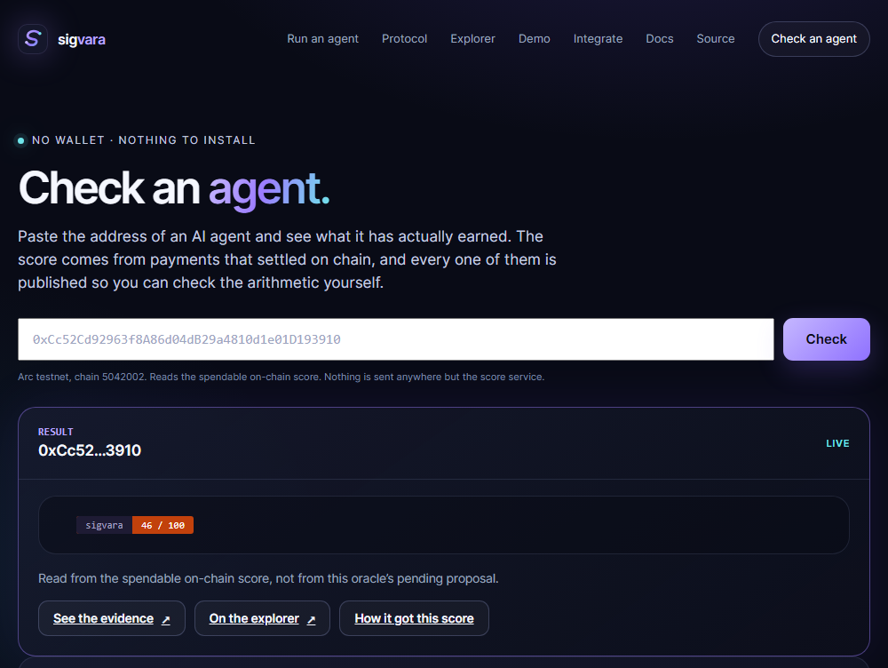
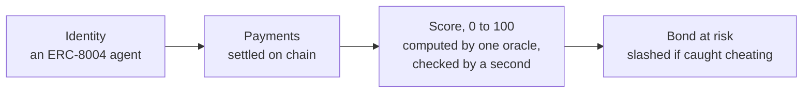

# Sigvara

Anyone can start an AI agent, so how do you know one will pay you, or do the work it is paid for? Sigvara answers in one call: a score built from payments the agent actually settled on chain, and a bond it loses if it is caught cheating.

```ts
import { Contract, JsonRpcProvider } from "ethers";

const abi = ["function isTrusted(address,uint8,uint256) view returns (bool)"];
const provider = new JsonRpcProvider("https://rpc.testnet.arc.io");
const reader = new Contract("0x2921b4eE879CdF5793FA273BbDc4E7dF01ABcef8", abi, provider);

// Active, a score of at least 40, and a bond of at least 1,000 test SVR.
if (!(await reader.isTrusted(agent, 40, 1000n * 10n ** 18n))) throw new Error("not in good standing");
```

No account and no API key. [Check this live agent](https://sigvara.xyz/check?a=0xCc52Cd92963f8A86d04dB29a4810d1e01D193910), or paste any address at [sigvara.xyz/check](https://sigvara.xyz/check).

[](https://sigvara.xyz/check?a=0xCc52Cd92963f8A86d04dB29a4810d1e01D193910)

## What you get back

That agent is our demo agent. On 21 November 2026:

| | |
|---|---|
| Status | Active |
| Score | 46 out of 100: payment volume 19, delivery 9, age 13, community 5 |
| Bond at risk | 5,000 test SVR |
| Payments | 11 settled on chain since 18 September, from 9 different payers, every one marked delivered |
| `isTrusted(agent, 40, 1,000 SVR)` | `true` |

Every payment behind the score is [published](https://oracle.sigvara.xyz/evidence/0x8414ce0bf4f1e1695193623e0a656a9439e356f8bed0b8bf249b179fe77c7e19), so you can redo the arithmetic, and [this page](https://sigvara.xyz/epochs?a=0xCc52Cd92963f8A86d04dB29a4810d1e01D193910) shows how the score got there. 46 is a short record: 11 payments in six weeks. A score under about 60 says little on its own, and no agent can pass 70 today, since two of the six factors need ERC-8004 feedback that no agent has yet. Read [what a fake score costs](docs/whitepaper.md#53-what-a-fake-score-costs) before you pick a threshold.

## How it works



## Where it stands

- Runs on Arc testnet. We run both oracle operators.
- Not audited yet: the [roadmap](docs/roadmap.md#mainnet) puts an external audit after the staking upgrade. To report a problem, see [SECURITY.md](SECURITY.md).
- Slashing has been tested live on testnet: [the drill log](docs/slash-drill-log.md).

## Read more

- [How scoring works](docs/reputation-model.md)
- [How slashing works](docs/overview.md#slashing-model)
- [What you must trust today](docs/whitepaper.md#51-what-you-must-trust-today)
- [Integrate it](https://sigvara.xyz/integrate): the [SDK on npm](https://www.npmjs.com/package/@sigvara/protocol-sdk), a contract call, and a gate for an agent that has to prove who it is
- [Run an operator](oracle/RUNBOOK-second-operator.md)
- [Security](SECURITY.md)
- [The whitepaper](docs/whitepaper.md)
- [The protocol in depth](docs/overview.md): contracts, flows, the SDK, testing and access control
- [Roadmap](docs/roadmap.md), [wiki](https://github.com/RunTimeAdmin/Sigvara/wiki), [status](https://sigvara.xyz/status) and [who builds this](docs/WHO.md)
- Looking for the hosted Countersig platform? It is a separate product: [how they differ](docs/overview.md#this-repo-vs-the-countersig-hosted-platform)

Bond token SVR: the only genuine address is `0xc79298521Ae84e7a43d20E71A2B2A1BB540E889B` on Arc mainnet. Details in [docs/token.md](docs/token.md).

MIT, for the code. Sigvara™ is a trademark, and the license does not cover the name.
