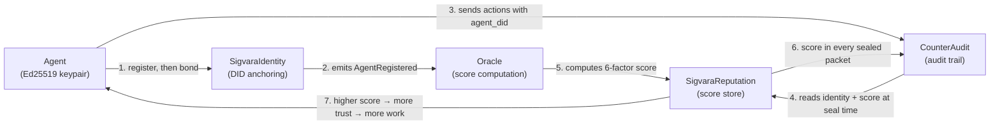

# The Sigvara Ecosystem

Sigvara is a protocol, not a single product. It works by connecting five components that reinforce each other. This document explains each component and how data flows between them.

---

## Components

### SigvaraIdentity (on-chain)

The DID registry. When an agent registers, the contract computes a `didHash` from the agent's Ethereum address and chain ID, stores the operator address and Ed25519 public key, and emits an `AgentRegistered` event. The agent now has a globally unique, chain-anchored identifier: `did:sigvara:<chainId>:<agentAddress>`.

### SigvaraReputation (on-chain)

The reputation store. The oracle writes a 6-factor score (0–100) here every epoch. Any on-chain contract or off-chain consumer can call `getTotalScore(didHash)` or `meetsThreshold(didHash, minScore)`. The contract stores and serves; it does not compute.

### SigvaraStaking (on-chain)

The bond. An agent registers first and lands in `PendingBond`; the first deposit that carries it over `minimumStake` is what makes it `Active`, scoreable and slashable. If the agent misbehaves, the slashing committee initiates a slash: the agent is suspended, a 7-day challenge window opens, and if unchallenged the bond is burned/distributed, reputation is zeroed, and the agent is permanently terminated. If the operator disputes it, the admin rules; the admin can also veto it, and a proposal nobody executes lapses after 14 days.

### Oracle

An off-chain service that watches the `AgentRegistered` events on Identity, aggregates its signals (payment volume verified on chain, outcomes signed by the payer or reported by a token holder, tenure, counterparty standing, watchdog flags, external ERC-8004 trust), and calls `proposeReputation()` on the Reputation contract every epoch, committing to the evidence it used with a Merkle root. Proposed scores sit through a challenge window (rejectable by the slashing committee) before anyone can call `finalizeReputation()` to make them live. The reference implementation is in `oracle/`. Two bonded operators run today. The primary proposes; a second, in checker mode on separate hardware and a separate RPC provider, recomputes each pending score from payment evidence it re-verified itself and records any disagreement, without ever overwriting a live proposal. A watcher on a third host polls that record and alerts while the challenge window is still open. Both operators are bonded in `SigvaraOracleBond`, so a bad proposal costs its proposer. What remains is operators run by *independent parties*: today they are not.

### CounterAudit (first integration, common ownership — see below)

CounterAudit is a tamper-evident AI audit trail service. An ingest call carrying an `agent_did` field makes CounterAudit query Sigvara at seal time, embed the agent's on-chain identity and reputation score inside the AES-GCM seal, and attach an RFC 3161 timestamp. The property that makes it worth having is that the score is captured *at the moment of the action* and frozen into a tamper-evident record, rather than looked up later from a score that has since moved.

> **Enrichment live as of 19 September 2026; the outcome relay off in production since 30 October 2026; payer-signed outcomes carried since 1 November 2026.** It was broken for the two days after the rename — the code still parsed `did:countersig:` and hashed that prefix, and was still pointed at the predecessor deployment on Robinhood Chain — so every lookup silently missed. Outcome reporting was separately broken, posting without the `payment.txHash` the oracle requires. All fixed and verified against real traffic. Since 30 October 2026 CounterAudit relays an org's reported outcome only for orgs it allowlists, and its production deployment allowlists none. Outcomes the payer signed take a separate connector with no allowlist: CounterAudit checks the signature, seals the record and forwards it to the operators, and the first went through on 1 November 2026 (see [payer-signed outcomes](counteraudit-integration.md#payer-signed-outcomes)).

---

## Where Sigvara sits in CounterAegis

Sigvara shares an owner with [CounterAegis](https://counteraegis.com), a suite of three
trust products. Stating that plainly matters more than the positioning does, so it comes
first: **CounterAudit is not an arm's-length third party.** The same people run both. It is
the intended carrier of outcome attestations, so anyone weighing how
independent this reputation signal is should weigh that too. It is an oracle run by one party today by the
same token, which the README says as well.

CounterAudit both reads the score and writes to it, so that concentration is live
rather than prospective. What it writes has narrowed. Its relay of an org's reported
outcome, which the oracle took on CounterAudit's token, has been off in production since
30 October 2026. Since 1 November it carries outcomes the payer signed
([ADR 0006](adr/0006-payer-signed-outcomes.md)), which every operator checks against the
payer itself; CounterAudit cannot forge one, and anyone can post the same signature to an
operator directly. Every outcome is bounded by the same rules either way: the payment is
verified on chain, one counterparty's evidence is capped, and everything decays. Worth settling the independence question sooner rather than later.

The suite divides by question:

| Question | Product | |
|---|---|---|
| Who acted? | [Countersig](https://countersig.com) | identity, policy and auth for humans and agents |
| What was touched? | [ProvenanceAI](https://provenanceai.network) | content fingerprinting, verification, lineage |
| Can we prove it? | [CounterAudit](https://counteraudit.io) | sealed packets, hash chain, RFC 3161, regulator exports |

Sigvara answers a fourth that none of them do: **should this agent be trusted, and what
does it lose if it defects?** The three products establish and evidence what happened
inside an organisation's boundary. Sigvara is what makes an agent's track record portable
and costly to fake outside it, because the bond and the score live on a public chain
rather than in anyone's database.

A naming note, since the history is confusing: this protocol was **Countersig Network**
until 17 September 2026 and is unrelated to the Countersig product above, which is
enterprise identity software. The rename to Sigvara removed the collision. See
[lineage.md](lineage.md).

### The coupling rule

Integrations are optional connectors, never runtime dependencies, in both directions.
CounterAudit already states it "runs standalone (no Countersig or ProvenanceAI runtime
dependency)", and Sigvara holds the same line: enrichment failures never block a seal, and
the oracle has no CounterAegis service in its critical path. A protocol whose liveness
depends on its owner's SaaS is not infrastructure, it is a product with extra steps.

---

## The Ecosystem Loop

All seven steps run today on Arc testnet. Steps 3, 4 and 6 went live on 19 September once
the DID-scheme mismatch above was fixed.




Step by step:

1. The operator generates an Ed25519 keypair and calls `registerAgent()`, with a signature from the agent address proving it controls itself. The DID is now globally resolvable, but the agent is `PendingBond`. A `depositStake()` over `minimumStake` makes it `Active`.
2. The oracle detects the `AgentRegistered` event and begins tracking the agent. It will not propose a score until the agent is bonded.
3. The agent does work. Every action is submitted to CounterAudit with the `agent_did` field.
4. Before sealing each packet, CounterAudit reads `getIdentity(didHash)` and `getTotalScore(didHash)` on-chain.
5. The oracle computes the 6-factor score from on-chain signals and writes it to SigvaraReputation.
6. The score — plus status, DID hash, chain ID, and enrichment timestamp — is embedded inside the sealed, timestamped packet.
7. Consumers query the sealed record. A low-reputation agent's packets are flagged. A high-reputation agent's packets carry a verified track record. Over time, reputation determines which agents get work.

---

## What Gets Sealed

These fields are in sealed packets today. Verified against a live packet on api.counteraudit.io.


Every CounterAudit packet whose ingest call includes `agent_did` will contain these fields inside the seal:

| Field | Type | Meaning |
|---|---|---|
| `agent_did` | string | The W3C DID: `did:sigvara:<chainId>:<address>` |
| `agent_did_hash` | hex string | The on-chain index key (`keccak256` of the packed DID) |
| `agent_chain_id` | number | EVM chain ID |
| `agent_reputation_score` | 0–100 | Total score at the moment of ingest |
| `agent_identity_status` | string | `PendingBond`, `Active`, `Suspended`, or `Slashed` |
| `agent_identity_verified` | boolean | `true` if registered and status is Active |
| `agent_enriched_at` | ISO 8601 | Timestamp of the enrichment query |

If enrichment fails for any reason (unregistered DID, RPC timeout, unsupported chain), `agent_identity_verified` is `false` and `agent_enrichment_error` explains why. The packet still seals — enrichment is never a blocking dependency.

---

## Why This Matters

Why this combination is the point.


Without Sigvara, an AI agent can claim to be anything. An audit trail records *what* happened but not *who* did it in any verifiable sense.

With Sigvara embedded in CounterAudit:

- Every action is tied to a cryptographically anchored identity.
- The agent's reputation at the time of each action is frozen into the tamper-evident record.
- If an agent is later slashed (stake burned, reputation zeroed), every audit packet from before the slash still shows what their reputation was then. The historical record does not rewrite itself.
- Consumers can filter, gate, and report on agent behavior using verified identity attributes rather than self-reported metadata.

This is the combination that makes the ecosystem defensible: staked identity + audited behavior + frozen-in-time reputation.

---

## Data Flow Reference

The call path as implemented, in `src/services/sigvaraService.js` on the CounterAudit side.


```
POST /v1/audit/ingest
  { connector_id, agent_did, raw_event }
        ↓
  CounterAudit ingest route
        ↓
  enrichWithSigvara(agent_did)
    → identityContract.getIdentity(didHash)   [eth_call → Arc]
    → reputationContract.getTotalScore(didHash) [eth_call → Arc]
        ↓
  packetService.ingestPacketAsync(event, agentIdentity)
    → bodyForHash = { ...raw_event, ...agentIdentity }
    → AES-GCM seal
    → SHA-256 entry hash
    → RFC 3161 timestamp request
    → Postgres insert
        ↓
  { packet_id, entry_hash, created_at }

GET /v1/audit/verify/:packet_id
        ↓
  AES-GCM decrypt
  → returns packet with all agent_* fields visible
```

---

## Circle's agent marketplace, and the two ways it settles

Circle ships an agent-wallet CLI with a paid-service marketplace: an agent searches for a
service, inspects its price, and pays it in USDC per call. That is the demand side of
exactly the market Sigvara scores, and it needs nothing from Circle to be useful here,
because a payment to a registered agent lands a `Transfer` log on chain and that log is
already what the oracle reads. Measured 3 Oct 2026 against Circle's published skills and
the Gateway contracts on Arc.

It settles two ways, and they are not equivalent for reputation.

**Vanilla x402 attributes correctly.** The payer signs an EIP-3009 authorization and a
facilitator broadcasts it, so the transaction sender is the facilitator while the
`Transfer` event's `from` is the payer. The oracle reads the log rather than `tx.from`, so
the counterparty is the paying agent, which is what
[payment-backed attestations](payment-backed-attestations.md) already assumed.

**Gateway does not attribute at all.** Gateway holds a pooled balance per source chain and
settles in under 500ms by *minting* on the destination chain: Circle's technical guide says
the minter "mints USDC to the specified destination". An ERC-20 mint emits
`Transfer(address(0), recipient, amount)`, so the payer is not merely hidden behind a
Gateway contract, it is the **zero address**.

What that would do to a score if such a mint reached a registered seller, measured against
the real scoring code with three different agents paying one seller (on Arc mainnet none
has yet, see [What Arc mainnet actually shows](#what-arc-mainnet-actually-shows)):

| | |
|---|---|
| credited | 3 of 3 |
| distinct payers seen | **1** |
| payer recorded | `0x0000…0000` |
| volume after the per-payer cap | 4 of 6 units |
| `feeScore` | **4 of 20** |

Every Gateway payment that arrived this way would collapse into one synthetic counterparty.
`distinctPayers` reads 1, `propagationScore` has no agent to inherit from and stays 0, and
`PAYMENT_MAX_PER_PAYER` caps the whole channel at four points however much business flows
through it. The payments are credited; they carry no identity. The self-payment refusal
does not fire either, because the zero address is nobody's operator.

**Circle's own guidance prefers the path that does not work.** Its skill says to always
prefer Gateway when a Gateway balance exists, and to treat the first paid call as wallet
onboarding whose purpose is making every later call Gateway-backed. Vanilla is the
documented exception, for when every seller is vanilla-only on a chain the buyer already
holds. The recommended default also deposits on Base and pays via Gateway on Polygon, so
the settlement need not touch Arc at all.

**There is a way through, at a price.** The attestation's transfer spec is hashed into the
mint transaction for traceability, so the depositor is recoverable from the Gateway mint
event even though it is absent from the `Transfer` log. Reading it would make marketplace
volume usable evidence. It would also couple this protocol to one payment provider's event
format, which is the kind of dependency the oracle has so far refused: it verifies settled
transfers precisely so it does not have to trust or track anyone's scheme. That trade is
not yet decided.

### What Arc mainnet actually shows

Measured 3 Oct 2026 by reading Arc mainnet (chain 5042) over public RPC: every USDC
transfer into and out of the marketplace's vanilla Arc sellers from block 21,000,000
(15 Sep), and every EIP-3009 authorization and every native mint from block 20,000,000
(9 Sep) to block 24,057,909, plus a sample of Gateway's own events. The marketplace lists
nothing on Arc testnet, so none of this can reach the testnet deployment as it stands.

**The vanilla half is about a dollar.** 78 of the 2,004 Arc listings accept vanilla x402,
and they belong to three sellers. Everything they were paid on Arc, 16 Sep to 3 Oct:

| Seller | `payTo` | x402 payments | USDC | Arm's length | Outside payers |
|---|---|---|---|---|---|
| BlockRun.AI | `0x634D274e67DafaF76C54153aa113906a606e1E0B` | 38 | 0.778677 | 0.778677 | 4 |
| Exa | `0xB98eF29eb2be19Ae646A8FC0248255B90A332dbC` | 35 | 0.300000 | 0.200000 | 14 |
| Vangrid | `0x1a8b69A1338C6E829E1Ced4c3007C79E945E4E70` | 3 | 50.020000 | 0.010000 | 1 |

0.746 of BlockRun.AI's total came from one wallet that has never sent a transaction of its
own, making 25 calls inside an hour on 3 Oct; the other sixteen days brought three cents. Two of Exa's payments are Exa paying
itself. Every seller's current balance reconciles, to within the gas it paid, against the
native transfer log described [below](#what-it-means-for-the-oracle), so nothing is
missing from the table.

**Vangrid paid itself, and the self-payment refusal would not have noticed.** On 27 Sep:

- 16:01 UTC, Vangrid sends 52 USDC to a new wallet `0x1c699da57dbc67de697fe818128892984a2e7d12`
  (`0xb706891a0d9ec29d0bf9b6d647a90063bf3c25aaab3115c27697b1c95d520708`).
- 16:24 and 16:27, that wallet pays Vangrid 0.01 and 50.00 over x402
  (`0x46f0b96913dee4821ae09542bcd01d4d90be9376d0f968a2541a0d453f9be15f`,
  `0x5f6e525cc19b74e8d1044493c5b064f0020d31d12a8ed251652d18eeea7dffdc`).
- 16:28, Vangrid sends the 50 back
  (`0xa9941bf7de4b929534db30c3dad5ee61761004b111517340f2af8c156385650b`).

Its other inflows are 151 USDC of its own money sent out to, and straight back from, its
own contract `0xdd5f15a2c4b324d881cb7826de8e5232ad99986e`. Its one arm's-length payment is
0.01 USDC from a Circle wallet. The refusal compares the payer with the agent's operator,
and a wallet the agent funded 23 minutes earlier passes it, as does the agent's own
contract.

**Who pays is the useful part.** The three sellers have 17 distinct outside payers. Ten are
Circle smart-contract wallets: ERC-1967 proxies whose implementations
(`0x9c6e09bc32d1e012dcaa2623e66d2cc9860c1aed`, `0xd206ac7fef53d83ed4563e770b28dba90d0d9ec8`)
carry the string "Circle Internet Financial" and implement `isValidSignature`. One is an
EIP-7702 account delegated to Coinbase Smart Wallet, and six are plain EOAs. So Circle
wallets do buy over vanilla x402, and they are deployed contracts, which is what
SigvaraIdentity's ERC-1271 registration path needs. All 76 payments were broadcast by two
addresses, `0xa48381b79bba70ce4e98bcf71db43bad6ee1ad30` and
`0xa3dfb958c725cba41bc3dd8706eb638872436f5f`, which between them have sent 301 transactions
since they first appeared: a ceiling on everything they have ever settled on Arc.

**The Gateway half never reaches Arc.** The 1,928 Gateway listings resolve to 48 `payTo`
addresses. Since block 20,000,000 Arc has minted USDC 101,911 times to 32,060 recipients,
and not once to any of those 48 or to the two vanilla-only sellers. Gateway's contracts on
Arc (GatewayWallet `0x77777777dcc4d5a8b6e418fd04d8997ef11000ee`, GatewayMinter
`0x2222222d7164433c4c09b0b0d809a9b52c04c205`, which reports domain 26) name none of them
either, in topics or data, across blocks 23,558,185 to 24,057,093. That is 2.9 days, all the
history kept by the one provider that serves wide log ranges. What Gateway carries there is
treasury movement: 741 `GatewayBurned` events totalling 114.4M USDC, median 31,513, from
22 depositors, and 169 `AttestationUsed` mints, 94 of them a depositor moving its own
funds. Each of 29 sampled native mints was a CCTP `receiveMessage(bytes,bytes)` call to
`0x81d40f21f12a8f0e3252bccb954d722d4c464b64`, none a Gateway mint.

So the zero-address problem above is real but not yet reached: on Arc there is no mint to
misattribute. The sellers' Gateway revenue either does not exist yet or sits in Circle's
books until the seller withdraws, possibly to another chain. The way through above assumes
a per-payment event to read, and on Arc none has appeared.

**The rest of Arc's micropayment traffic is a ring.** There were 180,056 EIP-3009
authorizations from 6,032 payers in the window. Fifty payers made 148,424 of them (82%). In
a random sample of 137, one relayer (`0x2b9a3197ed35d56e2e1c2a01f4d649586821055c`) broadcast
131, the median payment was 0.001745 USDC, 128 of 141 transfers were under a cent, and 63 of
the 73 recipients were themselves payers elsewhere in the set. Arc's largest micropayment
flow is the closed loop that `PAYMENT_MAX_PER_PAYER` exists to discount.

### What it means for the oracle

**The scanner cannot see a plain USDC send.** Every change to a USDC balance on Arc emits
`Transfer` from the system address `0xfffffffffffffffffffffffffffffffffffffffe`, with an
18-decimal amount. A transfer made through the ERC-20 at `0x3600…0000`, which includes
every EIP-3009 payment, emits a second, 6-decimal `Transfer` from `0x3600…0000`. A plain
native send emits only the first: Exa's first 2 USDC
(`0xaf5f5e34a44f719212ef1a0e21ca0e7ef4933da9110fa2520aaac1afbd48298c`) and Vangrid's first
104 (`0x0137bb2bbdea9f9849d862fce0a1a35669ed05e6201d37c2a43ee26de88d4eb4`) have no
`0x3600…0000` log at all, and plain sends on testnet behave the same. `payment-scan.js`
filters on `address: asset` and `verifyPayment` reads `transfersTo(receipt, cfg.asset,
payTo)`, so with `PAYMENT_ASSET` set to `0x3600…0000` a payment made as a plain send is
invisible to both. Reading `0xffff…fffe` instead sees each payment once, whichever way it
was made, at 18 decimals. A transfer to oneself emits nothing there, and nothing is lost by
that because self-payments are refused anyway. The address has no code on either network,
so nothing deployed can emit from it. None of this affects the testnet deployment today,
which scores SVR; it has to be settled before `PAYMENT_ASSET` becomes USDC.

**Measured volume cannot carry `feeScore` in this market.** The three sellers' real
payments, run through `diversifiedVolume` and `feeScoreFromVolume` with only payments from
the agent itself removed, as the scanner would see them:

| `PAYMENT_FEE_UNIT` | BlockRun.AI | Exa | Vangrid |
|---|---|---|---|
| 100 USDC per point (the default) | 0 | 0 | 1 |
| 1 cent per point | 6 | 17 | 8 |
| 0.1 cent per point | 13 | 20 | 12 |

At the default the only point anyone earns is Vangrid's, and it is Vangrid's own money.
Any unit small enough to register marketplace revenue lets 20 cents buy 17 of 20 points,
and the ring shows that the distinct payers needed to clear the per-payer cap cost nothing.
The default's problem is the reverse of an invoice market's, where a single 2,548 USDC
invoice already earns its payer's whole cap of four points: no one unit serves invoices and
per-call payments at once. In a per-call market the weight has to come from who the payers are
(`trustWeight`, propagation), not from how much they paid.

**The self-payment refusal needs a funding check.** Matching the payer against the
operator misses both of Vangrid's routes. A payer that received its funds from the agent,
or from the agent's operator, shortly before paying is the same party, and would have
caught the 50.01.

The honest position is narrower than the settlement mechanics alone suggested. Circle's
wallets are real buyers on Arc and the vanilla path attributes them correctly, but the
marketplace revenue on Arc that Sigvara could ever see comes to about a dollar in seventeen
days. The larger flows on the same chain are either invisible to it, like Gateway, or
built to game it, like the ring.

## Related

- [Quickstart: Register your first agent](quickstart.md)
- [CounterAudit Integration Guide](counteraudit-integration.md)
- [Reputation Model](reputation-model.md)
